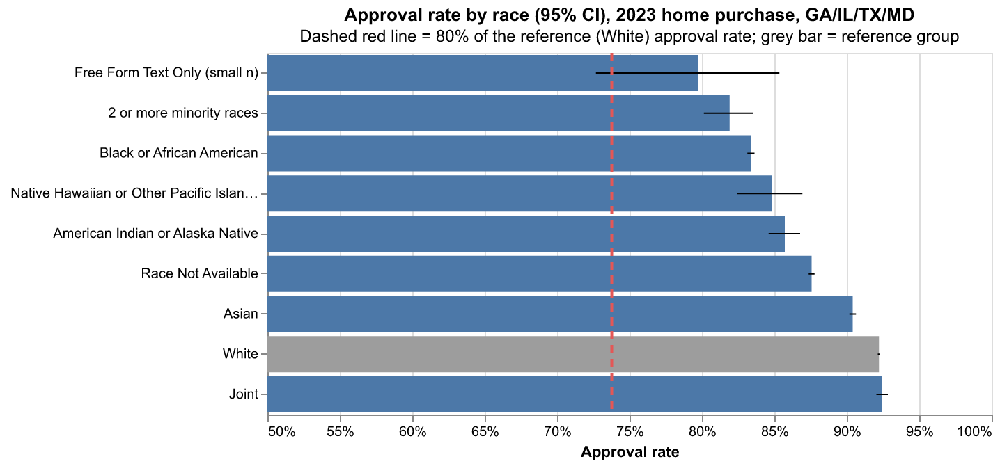
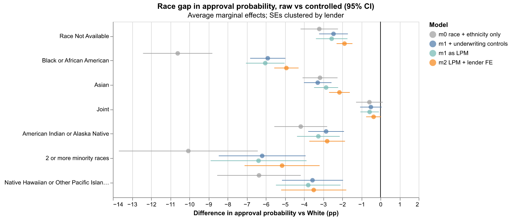
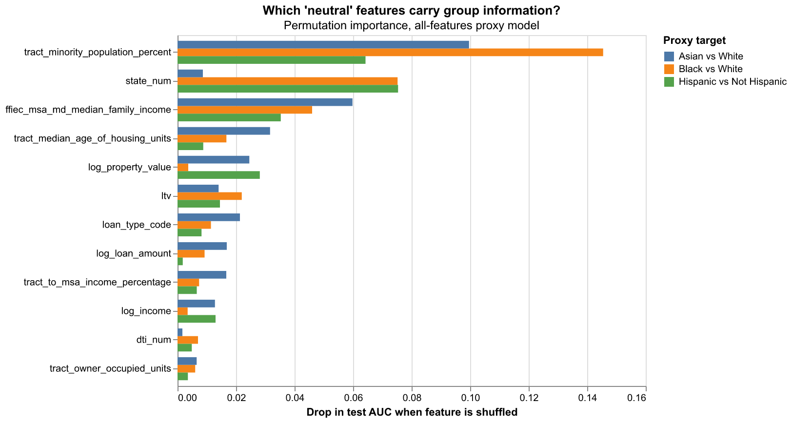
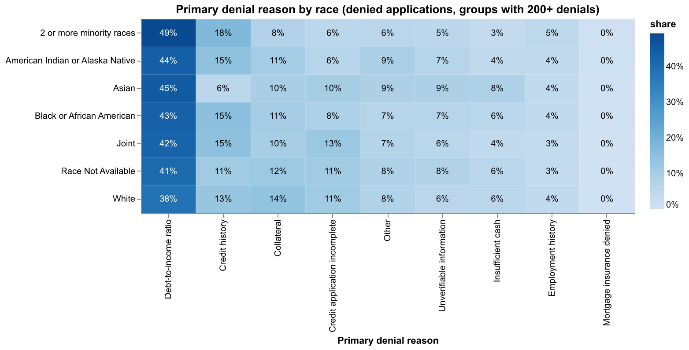

# Fair Lending Analysis on HMDA Mortgage Data

> In 635k 2023 home-purchase decisions across GA, IL, TX and MD, Black applicants were approved 8.8 percentage points less often than White applicants (AIR 0.904). About half of that gap remains after controlling for HMDA underwriting factors and lender (−4.9 pp). Neighborhood geography alone predicts applicant race with an AUC of 0.83. Removing it from a race-blind approval model narrows the disparity (AIR 0.902 → 0.929) at a cost of about 1 AUC point.

**Stack:** Python · pandas · statsmodels · pyfixest · scikit-learn · Altair

**Short version for a compliance reader:** [`reports/memo.md`](reports/memo.md)

---

## 1. Business and regulatory question

> Do applicants from different racial and ethnic groups receive approvals at different rates? Are those gaps explained by legitimate credit factors, or do they remain after controlling for them?

**Why a lender cares:** Fair lending laws (ECOA and Regulation B, and the Fair Housing Act) prohibit credit discrimination on protected bases. Regulators and internal compliance teams test for two things:

- **Disparate treatment:** treating applicants differently because of a protected characteristic.
- **Disparate impact:** a facially neutral policy or model that disproportionately harms a protected group, either without a sufficient business justification or when a less discriminatory alternative exists.

This project is a **statistical screening analysis**, the first thing a compliance or analytics team runs. It flags where to look. It cannot prove discrimination (see [Limitations](#5-limitations)).

<!-- DRAFT: personalize. This paragraph is meant to be in your own voice; rewrite it around your own interest in law. -->
Fair lending sits where statistics and law meet, so neither team can do this work alone. Risk & Analytics can measure a gap, but whether that gap is legally significant depends on questions only Legal and Compliance can answer: Is there a legitimate business justification? Is there a less discriminatory alternative? Which protected bases and which products are in scope? Legal, in turn, needs analysts to turn those questions into tests that can be repeated and defended. That pairing interests me because the legal concept of disparate impact maps directly onto how machine-learning models fail. A model that never sees race can still learn it from ZIP code, tract demographics or property values, because those features carry the history of segregation and unequal access to credit. Section 3, Step 3 of this project tests for exactly that: whether "neutral" inputs act as proxies, and whether removing them is a workable less-discriminatory alternative.

---

## 2. Data

| Item | Detail |
|---|---|
| Source | HMDA (Home Mortgage Disclosure Act) public loan-level data, from the CFPB/FFIEC Data Browser API |
| Scope | **2023; Georgia, Illinois, Texas, Maryland; home purchase; first lien; principal residence; single-family (1–4 unit) site-built; closed-end; not business-purpose; not reverse mortgage** |
| Grain | One row per application |
| Final sample | **635,352** lender decisions (TX 337k, GA 120k, IL 117k, MD 61k) from 1,399 lenders |
| Reproduce | `make data` (scripted API pull). [`data/README.md`](data/README.md) has the exact request URLs, file sizes and filter-by-filter row counts |

The four states were chosen because they have large Black, Hispanic and Asian applicant pools, which keeps group-level estimates stable. They also span the South and the Midwest.

### Outcome definition

| `action_taken` | Treatment | Count |
|---|---|---:|
| 1 Originated | **Approved** | 553,589 |
| 2 Approved, not accepted | **Approved**: the lender said yes and the applicant walked away | 18,335 |
| 3 Denied | **Denied** | 63,428 |
| 4 Withdrawn, 5 Incomplete | Dropped: no credit decision | 172,599 |
| 6 Purchased loan | Dropped: the reporting institution did not underwrite it | 217,007 |
| 7, 8 Preapprovals | Dropped: not an application for a specific property | 6,892 |

The analysis is about the *lender's decision*, so code 2 counts as an approval. As a sensitivity check, I re-ran everything with originated (1) vs. denied (3) only. Results hardly moved: the Black–White raw gap is −9.2 pp instead of −8.8, and the controlled gap is −6.2 pp instead of −5.9.

### Protected-class groups

All groups are HMDA's **derived** fields, which combine applicant and co-applicant information. No category was silently dropped. "Race Not Available", "Joint" and "Free Form Text Only" are kept as their own levels and reported.

| `derived_race` | Applications |
|---|---:|
| White *(reference)* | 362,980 |
| Race Not Available | 97,328 |
| Black or African American | 88,848 |
| Asian | 61,973 |
| Joint | 17,130 |
| American Indian or Alaska Native | 4,007 |
| 2 or more minority races | 1,951 |
| Native Hawaiian or Other Pacific Islander | 982 |
| Free Form Text Only | 153 |

**Reference groups:**

- **White** for race. It is the largest group and the conventional comparator in fair lending analysis. Note that the HMDA "White" group includes Hispanic White applicants. For that reason the regressions also include ethnicity as a separate control.
- **Not Hispanic or Latino** for ethnicity.
- **Male** for sex.
- **35–44** for age. It is a prime borrowing age, which avoids comparing against the youngest or oldest applicants.

Race and ethnicity get the full pipeline. Sex and age get the Step 1 raw screen only.

### Cleaning notes

- **Numeric fields arrive as strings**, with `NA` and `Exempt` mixed in. Both are parsed to missing, never to zero.
- **DTI is banded.** `debt_to_income_ratio` arrives as `<20%`, `20%-<30%`, `30%-<36%`, then exact values `36` to `49`, then `50%-60%` and `>60%`. I parse it two ways:
  - an ordered categorical `dti_band` (`<20`, `20-30`, `30-36`, `36-40`, `41-45`, `46-49`, `50-60`, `>60`), used in the regressions;
  - a numeric `dti_num`, with band midpoints for ranges and exact values for 36–49, used in the tree models.
- **LTV.** The Data Browser calls combined LTV `loan_to_value_ratio`. Values ≤0 or >150 are treated as data errors. Over 100 is kept, because FHA loans routinely exceed 100% CLTV once financed fees are included. For the regressions, CLTV is banded (`<=60`, `60-80`, `80-90`, `90-95`, `95-100`, `>100`) rather than forced into a linear form.
- **Income** is in $ thousands. Zero and negative values are left out of the log transform.
- **Regression sample.** The regressions drop 23,521 rows (3.7%) that are missing income, CLTV or DTI. Group shares and approval rates barely change: the Black share goes from 14.0% to 13.8%. The comparison is in `reports/tables/step2_sample_selection.csv`.
- `applicant_age = 8888` (not provided) is relabeled "Not available".
- The API accepts only two filter criteria per request and silently ignored `occupancy_types`. So the scope filters are re-applied locally, and each one's row drop is logged.

---

## 3. Method

```
HMDA API ──► download.py ──► clean.py ──► analysis.parquet
                                               │
      ┌────────────────────────────────────────┼────────────────────────────────┐
      ▼                                        ▼                                ▼
 1. Raw disparities                  2. Controlled regression           3. Proxy analysis
 disparities.py                      regression.py                      proxies.py
 (rates, AIR, z-tests,               (logit + AMEs; LPM with            (predict race from "neutral"
  Holm, CIs)                          lender fixed effects)              features; ablation)
      │                                        │                                │
      └───────────────┬────────────────────────┴────────────────────────────────┘
                      ▼
       4. Denial reasons ──► report.py ──► README + memo
```

### Step 1: Raw approval-rate disparities and the Adverse Impact Ratio

For each group, the screen computes:

- the approval rate with a Wilson 95% CI;
- the **AIR** (group approval rate ÷ reference approval rate);
- the difference in percentage points, with a Newcombe 95% CI;
- a two-proportion z-test against the reference group, with **Holm** correction across groups. Fisher's exact test is used as a cross-check wherever a cell count is under 10.

Groups under 500 applications are flagged `small_n`.

The **four-fifths (80%) rule** comes from EEOC employment-selection guidance. Lending analyses often borrow it as a rough flag, but it is **not a legal standard for credit**. Here it is a plotting reference only. With 635k applications, almost every gap is "statistically significant", so the size of the effect and its confidence interval matter more than the p-value.

### Step 2: Controlled regression

All models are fit on the same regression sample. Standard errors are clustered by lender (LEI).

| Model | Specification |
|---|---|
| **m0** | logit: `approved ~ race + ethnicity` |
| **m1** | logit: m0 + `log(income) + log(loan_amount) + C(CLTV band) + C(DTI band) + C(loan_type) + C(state)` |
| **m1 LPM** | linear probability model with m1's covariates, so it can be compared directly with m2 |
| **m2** | LPM with m1's covariates + **lender fixed effects** (1,399 LEIs, via `pyfixest`) |
| m1 strict | m1 re-fit on originated vs. denied only (sensitivity) |

**How to read the coefficients.** Logit coefficients are changes in log-odds. Exponentiating them gives odds ratios. For example, in m1 the odds ratio for Black applicants is 0.46: holding the controls fixed, Black applicants' odds of approval are about half those of White applicants. Odds ratios are hard to communicate, though, especially when approval is as common as 90%. So the headline numbers are **average marginal effects (AMEs)**. Each applicant is scored twice, once as a member of the group and once as the reference group, with all of their other characteristics held the same. The AME is the average difference in predicted approval probability, and the delta method gives its standard error. I computed AMEs this way instead of with `statsmodels`' `get_margeff`, because that function changes one dummy column at a time and so mishandles a multi-level categorical. In the LPMs, the coefficient *is* the AME.

**Why lender fixed effects.** Pooling across lenders mixes up two different stories. One is that groups are treated differently *within* the same lender. The other is that groups apply to *different* lenders, some of which deny more often. m2 compares applicants only within the same lender. That makes it the closer analogue to a single institution's own fair lending review.

**An important caveat.** The controls themselves (income, CLTV, loan size) can reflect historical inequality, such as wealth gaps, appraisal gaps and access to down-payment help. A small controlled gap means the disparity is *associated with measured factors*. It does not mean the system is fair.

**Sanity checks:** the log-income coefficient is positive, and DTI bands of 50–60% and >60% are strongly negative relative to <20%. All checks pass (`reports/tables/step2_sign_checks.csv`).

### Step 3: Proxy analysis (the ML-bias angle)

Race, ethnicity and sex are **never** model inputs here.

**(a) Can "neutral" features predict group membership?** I trained gradient-boosted classifiers (`HistGradientBoostingClassifier`, 70/30 stratified split, seed 42) to predict the binary group labels below from three feature sets:

- Black vs. White
- Asian vs. White
- Hispanic vs. Not Hispanic

| Feature set | Features |
|---|---|
| **Applicant/loan** | log income, log loan amount, log property value, CLTV, DTI, loan type |
| **Geography** | tract minority %, tract income as % of MSA, MSA median family income, tract owner-occupied units, tract median housing age, state |

An AUC well above 0.5 means the features leak group information. Permutation importance (the drop in test AUC when a feature is shuffled) shows which features do the leaking.

**(b) Ablation on an approval model.** I trained a race-blind approval model in three versions:

- A: all features
- B: no geography
- C: no tract minority %

Each model's scores are turned into decisions at the threshold that reproduces the observed training approval rate (about 90%). AIR is then computed on the predicted approvals in the test set. If dropping a proxy narrows the disparity at little cost in accuracy, that is a **less-discriminatory-alternative**-style finding, which is the concept regulators care about.

### Step 4: Denial reasons

Among denied applications, I tabulated the share of each primary denial reason (`denial_reason-1`) within each race group. The results are descriptive and only useful for generating hypotheses.

---

## 4. Results

All numbers below are generated by `make analyze` into [`reports/tables/`](reports/tables/). The markdown versions are in [`reports/tables/summary_tables.md`](reports/tables/summary_tables.md).

### 4.1 Main table: race

| Group | Applications | Approval rate | AIR vs White | Raw diff (pp) | m1 adj. AME (pp) [95% CI] | m2 lender FE (pp) |
|---|---:|---:|---:|---:|---|---:|
| White *(reference)* | 362,980 | 92.2% | 1.000 | — | — | — |
| Race Not Available | 97,328 | 87.6% | 0.950 | −4.7 | −2.5 [−3.2, −1.7] | −1.9 |
| **Black or African American** | 88,848 | 83.4% | **0.904** | **−8.8** | **−5.9 [−6.8, −5.0]** | **−4.9** |
| Asian | 61,973 | 90.4% | 0.980 | −1.8 | −3.3 [−4.0, −2.6] | −2.1 |
| Joint | 17,130 | 92.5% | 1.002 | +0.2 | −0.5 [−1.1, +0.1] | −0.4 |
| American Indian or Alaska Native | 4,007 | 85.7% | 0.930 | −6.5 | −2.8 [−3.8, −1.9] | −2.8 |
| 2 or more minority races | 1,951 | 81.9% | 0.888 | −10.3 | −6.2 [−8.5, −3.9] | −5.1 |
| Native Hawaiian or Other Pacific Islander | 982 | 84.8% | 0.920 | −7.4 | −3.6 [−5.2, −2.0] | −3.5 |
| Free Form Text Only *(small n)* | 153 | 79.7% | 0.865 | −12.5 | −2.8 [−8.9, +3.3] | −0.2 |



- **No group with 500 or more applications falls below the 0.80 four-fifths line.** The lowest AIRs are for 2+ minority races (0.888) and Black applicants (0.904). Mortgage approval rates are high overall (90%), which compresses ratios toward 1, so a 0.90 AIR still means a gap of almost 9 pp. This is one reason the four-fifths rule is a weak screen for lending.
- **Every gap except Joint is statistically significant after Holm correction.**
- **The pattern holds in every state.** The raw Black–White gap is −7.9 pp in TX, −8.9 pp in MD, −9.8 pp in GA and −12.2 pp in IL (`step1_race_by_state.csv`).
- **Ethnicity:** Hispanic applicants were approved at 87.9% vs 91.0% for non-Hispanic applicants (AIR 0.966, −3.1 pp). The controlled m1 odds ratio is 0.77 [0.69, 0.86].
- **Sex and age (Step 1 only):** Female applicants were approved 0.9 pp less often than male applicants (AIR 0.990). Age differences are within ±2.3 pp of the 35–44 group (AIR 0.98–1.03). The exception is the 119 applications with age not available.

### 4.2 Raw vs. controlled



| Black vs. White (pp) | m0 race + ethnicity | m1 controls | m1 LPM | m2 + lender FE | m1 strict outcome |
|---|---:|---:|---:|---:|---:|
| AME | −10.6 | −5.9 | −6.0 | −4.9 | −6.2 |

- Underwriting controls explain **about 45%** of the m0 Black–White gap (−10.6 → −5.9 pp). Lender fixed effects take away another 1.1 pp, which suggests that part of the pooled gap reflects *which lenders* Black applicants used. Even so, a gap of about 5 pp remains **within the same lender**, after controlling for the measured factors.
- The m0 gap (−10.6) is larger than the raw −8.8 because m0 also controls for ethnicity. That moves Hispanic White applicants, who are approved less often, out of the White baseline.
- **Asian applicants' gap grows after controls**, from −1.8 raw to −3.3 pp. Their measured profiles (income, CLTV) are stronger on average, so the controls predict *higher* approval than they actually got.
- The pseudo-R² goes from 0.02 (m0) to 0.20 (m1). The measured factors explain much of the variation in approval, but far from all of it, which is consistent with credit scores being the big missing variable.

### 4.3 Proxy analysis

**Test AUC for predicting group membership from race-blind features:**

| Feature set | Black vs White | Asian vs White | Hispanic vs Not Hispanic |
|---|---:|---:|---:|
| Applicant/loan only | 0.720 | 0.762 | 0.715 |
| **Geography only** | **0.831** | **0.830** | **0.788** |
| All features | 0.856 | 0.850 | 0.813 |



Geography is the strongest proxy. Six tract- and MSA-level fields alone separate Black from White applicants with an AUC of 0.83. **Tract minority population %** is the single most informative feature for all three targets. Shuffling it costs 0.145 AUC for Black vs. White. State and MSA median income follow. The applicant-level loan features also leak a fair amount (AUC 0.72–0.76), mostly through property value and CLTV.

**Ablation on the approval model (test set, race-blind, threshold set to match the observed approval rate of about 90%):**

| Model | Test AUC | AIR Black | AIR Asian | AIR AIAN | AIR 2+ minority | Min AIR |
|---|---:|---:|---:|---:|---:|---:|
| *Observed lender decisions* | — | 0.909 | 0.982 | 0.920 | 0.889 | 0.889 |
| A: all features | 0.8105 | 0.902 | 0.994 | 0.940 | 0.910 | 0.902 |
| **B: drop all geography** | **0.7997** | **0.929** | 1.000 | 0.949 | 0.923 | **0.923** |
| C: drop tract minority % only | 0.8097 | 0.908 | 0.995 | 0.942 | 0.917 | 0.908 |

- **Dropping geography raises the minimum AIR from 0.902 to 0.923, at a cost of 1.1 AUC points.** That is the shape of a less discriminatory alternative: a meaningful reduction in disparity for a small loss in accuracy. Whether the tradeoff is acceptable is a business and legal judgment, not a statistical one.
- **Dropping only tract minority % barely helps** (0.902 → 0.908), because the other geographic fields reconstruct it. Removing the obviously sensitive column is not enough; the information has to be removed.
- Model A's Black AIR (0.902) is close to the AIR of the observed decisions (0.909). An approval model trained on these outcomes, without ever seeing race, reproduces the observed disparity.

### 4.4 Denial reasons (denied applications)



DTI is the most common primary denial reason in every group. It accounts for 43% of denials of Black applicants and 38% for White applicants. Credit history is cited a little more often for Black applicants (15% vs 13%), and collateral less often (11% vs 14%). Asian applicants' denials are less often for credit history (6%) and more often for insufficient cash or unverifiable information. These differences generate hypotheses (for example, about DTI policy thresholds); they do not establish cause.

### 4.5 Summary

> Raw approval rates differ by 8.8 pp between Black and White applicants (AIR = 0.904). After controlling for income, loan size, CLTV, DTI, loan type and state, the gap falls to 5.9 pp (95% CI: 5.0–6.8). With lender fixed effects it falls to 4.9 pp. Geographic features predict Black vs. White group membership with an AUC of 0.83. Removing them from a race-blind approval model raises the minimum AIR from 0.902 to 0.923, at a cost of 1.1 AUC points.

These results are a **screening flag** for deeper review, not a finding of discrimination. The memo lists the next steps.

---

## 5. Limitations

- **HMDA has no credit scores.** It also lacks reserves, full credit history, employment details and AUS findings. This is the most important caveat. Omitted-variable bias cuts both ways: the remaining 5–6 pp gap may partly reflect unmeasured credit quality, and a gap that disappeared would not prove fairness. A lender doing this for real would add its own underwriting data.
- **The controls may embed inequality.** Income, CLTV and property value reflect wealth and appraisal gaps that are themselves tied to race.
- **The lender fixed effects pool across states and products.** Within-lender gaps may differ by market or channel, and a lender's applicant pool is not random.
- **This is observational data.** It shows associations, not proof of intent or causation.
- **The four-fifths rule is a screening heuristic.** It is not a legal test for lending, and with approval rates around 90% it is a weak one.
- **Group definitions** are HMDA's derived categories. "Race Not Available" is 15% of the sample and is not random. "White" includes Hispanic White applicants.
- **The regression sample** drops 3.7% of rows for missing income, CLTV or DTI. Group mix and approval rates barely change.
- **Scope:** one year, four states, home purchase only. The results may not generalize.
- This analysis is for education and portfolio purposes. It is **not a compliance determination** about any lender.

---

## 6. AI-assisted development note

<!-- DRAFT: personalize. Edit to reflect what you personally reviewed. -->
I built this project with an AI coding assistant (Claude Code). I set the scope (states, outcome definition, which groups get the full pipeline, lender fixed effects), and I treated its output as a draft to verify, not as an answer. These checks were run:

- **Counts add up.** Group counts for race, ethnicity, sex and age sum to the full sample. This is asserted in `clean.py`, and the toy-data `disparity_table` totals are checked in `tests/test_disparities.py`.
- **AIR and z-test by hand.** Unit tests compare the AIR and two-proportion z-test against hand-computed values on a toy table. On the real data, I recomputed the Black AIR from the raw counts: (74,088 / 88,848) ÷ (334,750 / 362,980) = 0.9042. The pooled z statistic came out at −80.4, which matches the pipeline.
- **Parsing rules.** There are unit tests for every DTI string format, for `NA`/`Exempt` handling, for the CLTV bounds and for the `action_taken` mapping (23 tests, `make test`).
- **Coefficient signs.** Log income is positive, and high DTI bands are negative. These checks are written to `step2_sign_checks.csv` on each run.
- **Train/test separation.** Both proxy pipelines assert that the train and test indices are disjoint.
- **Bugs and surprises caught along the way:**
  - The Data Browser API silently ignored a filter, so the filters are now applied and logged locally.
  - Under statsmodels 0.15, the planned `get_margeff` approach turned out to mishandle multi-level race dummies, so the AMEs are computed counterfactually instead.
  - The m0 gap is larger than the raw gap, and the reason (the ethnicity control) had to be worked out rather than assumed.

---

## 7. Reproduce

Requires Python 3.11+ (built on 3.13) and GNU make. On Windows, `choco install make`. The full run takes about 2 minutes after the download (about 500 MB).

```bash
python -m venv .venv
source .venv/bin/activate        # Windows: .venv\Scripts\activate
make setup     # pip install -r requirements.txt
make data      # API pull -> data/raw/ (see data/README.md for exact requests)
make clean     # -> data/processed/analysis.parquet + cleaning log
make analyze   # Steps 1-4 -> reports/tables, reports/figures, reports/results.json
make test      # unit tests
```

Without activating the venv, use `make all PY=.venv/Scripts/python` on Windows or `PY=.venv/bin/python` elsewhere. `make clobber` deletes generated outputs but keeps the raw downloads. Each module can also be run on its own, for example `python -m src.regression`.

## 8. Repo layout

```
.
├── README.md                 # this write-up
├── Makefile                  # setup / data / clean / analyze / test / all / clobber
├── requirements.txt          # pinned
├── data/
│   ├── README.md             # API requests, filters, row counts
│   ├── raw/                  # gitignored: hmda_2023_{GA,IL,TX,MD}.csv
│   └── processed/            # gitignored: analysis.parquet
├── src/
│   ├── config.py             # scope, filters, reference groups, feature lists
│   ├── download.py           # FFIEC Data Browser API pull
│   ├── clean.py              # filters, parsing, cleaning log
│   ├── disparities.py        # Step 1 (AIR, tests) + Step 4 (denial reasons)
│   ├── regression.py         # Step 2 (logit AMEs, LPM, lender FE)
│   ├── proxies.py            # Step 3 (proxy AUC, permutation importance, ablation)
│   ├── report.py             # results.json + summary_tables.md
│   └── pipeline.py           # CLI used by the Makefile
├── tests/                    # parsing + hand-computed AIR/z-test checks
└── reports/
    ├── memo.md               # one-page compliance-style memo
    ├── results.json          # headline numbers
    ├── figures/              # PNG + interactive HTML
    └── tables/               # every number cited above
```
